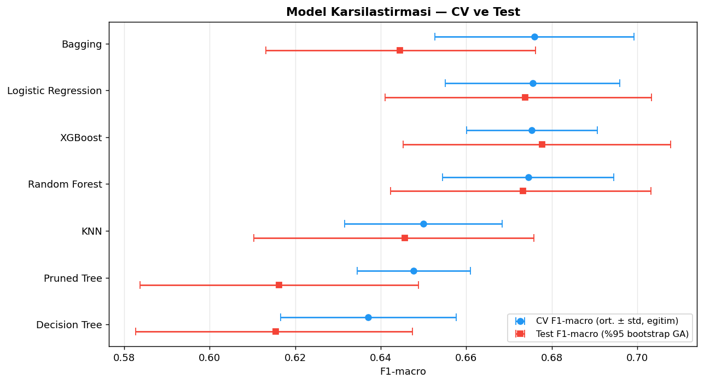
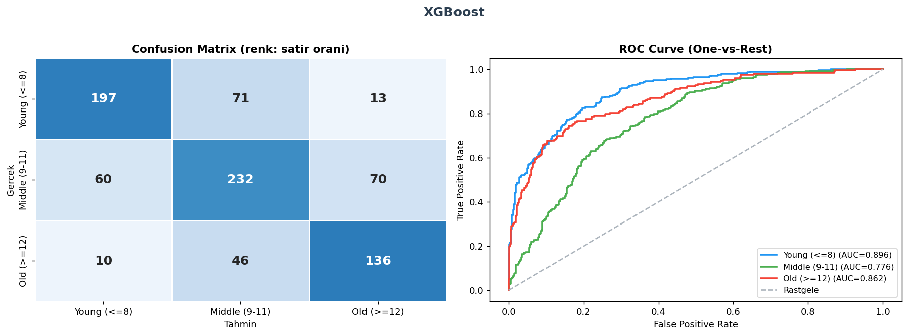
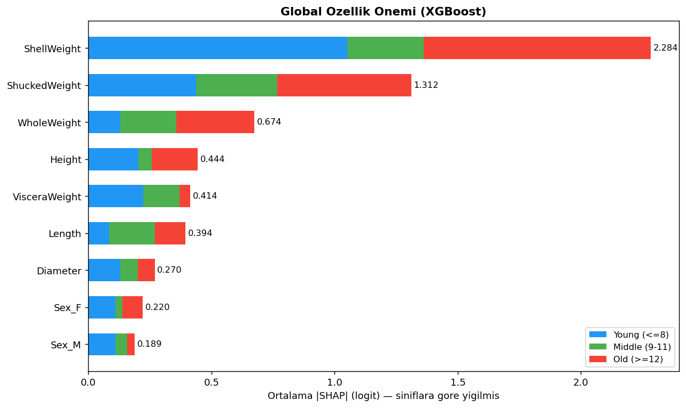
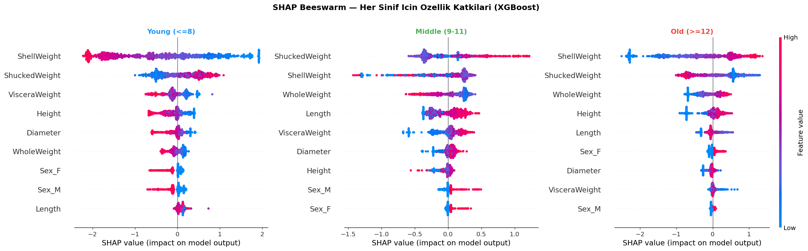

# 🐚 Abalone Yaş Grubu Sınıflandırması


Abalone'nin yaşı normalde kabuk kesilip halkalar mikroskop altında sayılarak bulunur. Bu yavaş ve
zahmetli bir laboratuvar işlemidir. Bu projede yaş grubunu **yalnızca dışarıdan alınabilen fiziksel ölçümlerle**
(boyut, ağırlık, cinsiyet) tahmin eden **7 denetimli öğrenme modeli** kurdum. Modelleri sızıntısız bir değerlendirme
düzeniyle karşılaştırdım ve en iyi modelin kararlarını **SHAP** ile açıkladım.

> 📓 **Tüm analiz, kod ve çıktılar:** [`abalone_final.ipynb`](abalone_final.ipynb)

---

## ✨ Öne Çıkanlar

- **7 model, tek bir adil karşılaştırma:** Lojistik Regresyon, KNN, Karar Ağacı, Budanmış Ağaç (cost-complexity pruning),
  Bagging, Random Forest ve XGBoost. Hepsi aynı CV katlarında ve aynı ölçütle (F1-macro) ayarlandı.
- **Sızıntısız değerlendirme:** ölçekleme ve SMOTE `Pipeline` içinde, yalnızca eğitim katlarına uygulanıyor.
  Hiperparametre ve strateji seçiminin tamamı eğitim setinde CV ile yapılıyor. Test seti en sonda **bir kez** kullanılıyor.
- **Dengesizlik stratejileri deneysel olarak karşılaştırıldı:** dengeleme yok, `class_weight` ve kategorik değişkenlere
  uygun **SMOTENC**. XGBoost için eşdeğer `sample_weight` kullanıldı ve metadata routing ile yalnızca `fit`'e iletildi.
- **Belirsizlik raporlandı:** CV standart sapması ve test F1 için **bootstrap %95 güven aralıkları** hesaplandı.
  "En iyi model" iddiası istatistiksel olarak sınandı.
- **Açıklanabilirlik:** SHAP ile global önem, sınıf bazında beeswarm, dependence, waterfall ve decision plot çizildi.
  Grafik yorumları sayısal bir yön tablosuna (Spearman ρ) dayanıyor.
- **Uygulama katmanı:** ipywidgets ile etkileşimli bir tahmin aracı yaptım. Ölçümleri gerçek birimlerle (mm, g) alıyor,
  tahmin olasılıklarını ve SHAP katkılarını gösteriyor. Groq üzerinden Llama 3.1 ile doğal dilde yorum ekliyor.

---

## 📊 Sonuçlar

Test seti 835 gözlemden oluşuyor ve tüm modeller `class_weight` stratejisiyle eğitildi:

| Model | CV F1-macro (eğitim) | Test F1-macro | Test %95 GA | Test ROC-AUC |
|---|---|---|---|---|
| **XGBoost** | 0.675 ± 0.015 | **0.678** | [0.645, 0.708] | **0.844** |
| Lojistik Regresyon | 0.676 ± 0.020 | 0.674 | [0.641, 0.703] | 0.838 |
| Random Forest | 0.675 ± 0.020 | 0.673 | [0.642, 0.703] | 0.835 |
| Bagging | 0.676 ± 0.023 | 0.645 | [0.613, 0.676] | 0.826 |
| KNN | 0.650 ± 0.018 | 0.646 | [0.610, 0.676] | 0.821 |
| Budanmış Ağaç | 0.648 ± 0.013 | 0.616 | [0.584, 0.649] | 0.800 |
| Karar Ağacı | 0.637 ± 0.021 | 0.615 | [0.583, 0.647] | 0.806 |

<p align="center"></p>

**Çıkarımlar**

- **XGBoost, Random Forest, Bagging ve Lojistik Regresyon istatistiksel olarak başabaş.** CV skorları 0.674–0.676 aralığında
  ve güven aralıkları büyük ölçüde örtüşüyor. Basit lojistik regresyonun topluluk modelleri kadar iyi olması, karar sınırlarının
  büyük ölçüde monoton olduğunu gösteriyor. Tek karar ağaçları ve KNN belirgin şekilde geride.
- **Hatalar ağırlıkla komşu sınıflar arasında.** XGBoost'ta Young ↔ Old karışıklığı 835 tahminde yalnızca 23 kez görüldü.
  Hedef sıralı olduğu için bu beklenen bir durum. En zor sınıf iki komşusu da olan **Middle**.
- `class_weight` küçük bir iyileşme sağladı, SMOTE ise katkı sağlamadı. Dengesizlik yalnızca orta düzeyde (en büyük/en küçük sınıf ≈ 1.9).
- F1 ≈ 0.68 tavanı verinin doğasından geliyor: büyüme yaşla yavaşladığı için aynı boyuttaki iki abalone çok farklı yaşta olabiliyor.

<p align="center"></p>

---

## 🔍 Model Ne Öğrendi? (SHAP)

<p align="center"></p>

- **Kabuk ağırlığı (ShellWeight) yaşın en güçlü göstergesi.** Değeri arttıkça *Old* skoru artıyor (ρ = +0.98), *Young* skoru düşüyor (ρ = −0.98).
- **Et ağırlığı (ShuckedWeight) ters yönde çalışıyor.** Diğer ölçümler sabitken etli bireyler daha genç tahmin ediliyor.
  Biyolojik karşılığı şu: yaşlandıkça kabuk kalınlaşıyor ve toplam ağırlık içinde etin payı azalıyor.
- İki değişken birbiriyle yüksek korelasyonlu, ama modeldeki katkıları **zıt yönlü**. Bu yüzden SHAP değerlerini nedensel etki olarak
  değil, modelin korelasyonlu değişkenler arasında katkıyı nasıl paylaştırdığı olarak yorumladım.

<p align="center"></p>

---

## 🛠️ Yöntem

```
Ham veri (4177)
  └─ Alan bilgisine dayalı temizlik: Height = 0 ve fiziksel olarak tutarsız Height/Length oranı → 4173
       └─ Stratified %80 / %20 ayrım
            ├─ Eğitim (3338)
            │    ├─ GridSearchCV — 5 katlı Stratified CV, F1-macro
            │    │    (Pipeline: [SMOTENC] → [StandardScaler] → model)
            │    ├─ Dengesizlik stratejisi seçimi: Yok / class_weight / SMOTENC (CV)
            │    └─ Final modeller tüm eğitim setinde yeniden eğitilir
            └─ Test (835) — yalnızca bir kez: metrikler, ROC-AUC, bootstrap GA, SHAP
```

| Aşama | Ayrıntı |
|---|---|
| Keşifsel analiz | Tanımlayıcı istatistikler, dağılımlar, IQR aykırı gözlem analizi ve aykırıların sınıflara göre dağılımı |
| Hedef | `Rings` → Young (≤8), Middle (9–11), Old (≥12). Sıralı kodlandı. `Rings` özellik olarak kullanılmadı |
| Özellikler | 7 sürekli ölçüm ve one-hot `Sex` (referans: yavru) |
| Metrikler | Accuracy, macro Precision / Recall / **Specificity** / F1, OvR macro ROC-AUC |

---

## 🚀 Çalıştırma

```bash
git clone https://github.com/suleymanrubaroral/abalone-yas-siniflandirma.git
cd abalone-yas-siniflandirma
pip install -r requirements.txt
jupyter notebook abalone_final.ipynb
```

- Veri seti ilk çalıştırmada OpenML'den otomatik olarak indirilir.
- Etkileşimli araçtaki LLM yorumu isteğe bağlıdır. Kullanmak için `GROQ_API_KEY` ortam değişkenini tanımlayın.
  Değişken tanımlı değilse araç LLM yorumu olmadan çalışır.

## 📁 Klasör Yapısı

```
├── abalone_final.ipynb   # tüm analiz (çıktılarıyla)
├── figures/              # notebook'un ürettiği grafikler
├── requirements.txt
└── README.md
```

## 🔭 Geliştirme Fikirleri

- Hedefin sıralı yapısını kullanan yöntemler: ordinal regresyon ya da `Rings` üzerinde regresyon ve ardından eşikleme
- Sınıf sınırlarına (8 / 11 halka) duyarlılık analizi
- Olasılık kalibrasyonu (reliability diagram, Brier skoru)
- Tahmin aracını Streamlit veya FastAPI ile bağımsız bir servis hâline getirme

---

<details>
<summary><b>🇬🇧 English summary</b></summary>

Multi-class classification of abalone age groups (Young / Middle / Old) from physical measurements.
Seven supervised models (Logistic Regression, KNN, Decision Tree, cost-complexity-pruned tree, Bagging,
Random Forest, XGBoost) are tuned with GridSearchCV under a **leakage-free** setup: scaling and SMOTENC
live inside pipelines, every model-selection decision is made with 5-fold CV on the training set, and
the hold-out test set is used exactly once. Results are reported with CV standard deviations and bootstrap
95% confidence intervals. The top four models are statistically tied at F1-macro ≈ 0.68 and ROC-AUC ≈ 0.84.
SHAP analysis shows that shell weight is the strongest age signal and that shucked (meat) weight
pushes predictions toward *younger* once the other measurements are held fixed. An interactive ipywidgets
tool combines model predictions and SHAP attributions with an LLM-generated explanation (Llama 3.1 via Groq).

</details>
